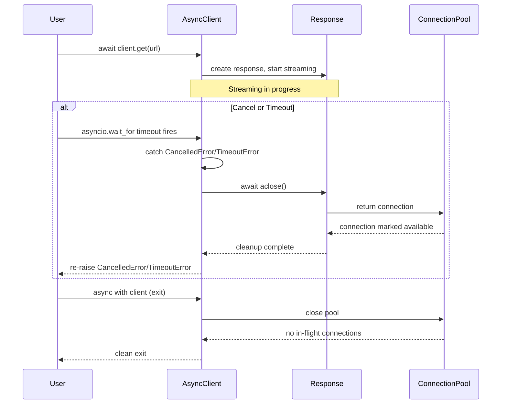
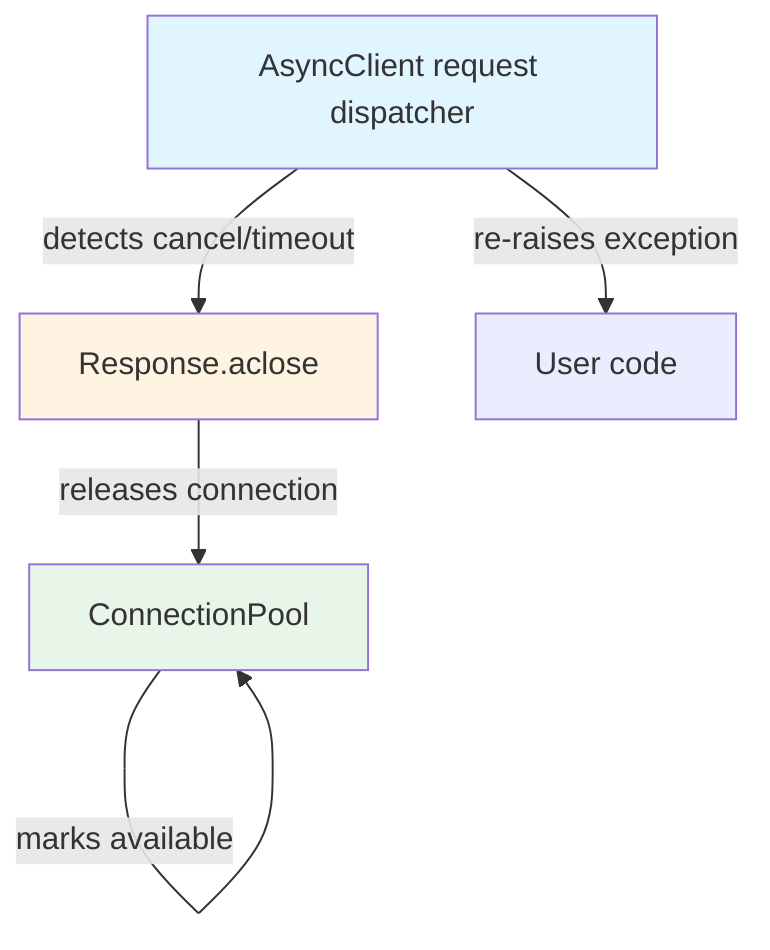

# HLD — Close response stream when async request is cancelled mid-read

**Ticket:** PER-81  
**Type:** Bug  
**Epic:** (standalone)  
**Altitude:** Story  
**Date:** 2025-01-23

---

## Overview

When an `AsyncClient` request is cancelled or times out while streaming a response body, the response stream is not properly closed. This leaves the connection marked as in-flight, causing a `RuntimeError` when the client context manager exits. The fix requires clarifying ownership of response cleanup during exceptional flow (cancel/timeout) and ensuring the connection is returned to the pool in all async interrupt scenarios.

The behavioral outcome: after a cancel or timeout during streaming, the response stream closes, the connection returns to the pool, and the `AsyncClient` context exits cleanly without raising an in-flight connection error.

---

## Architecture Decisions

### AD-1: Response cleanup ownership on async cancel/timeout

**Binds:** The `AsyncClient._send_single_request` coroutine (or the layer that awaits the response read) owns detecting cancellation/timeout and invoking response cleanup.  
**Prevents:** Divergence where some code paths assume the response auto-closes and others expect the caller to close it.  
**Rule:** When a `CancelledError` or `TimeoutError` is caught during response streaming, the response's `aclose()` method is called before re-raising the exception. The response object encapsulates connection pool release logic, so calling `aclose()` is sufficient to return the connection to the pool.  
**Status:** `[ADOPTED]` — matches existing httpx async response lifecycle.

### AD-2: Response stream closure mechanism

**Binds:** `httpx.Response.aclose()` (async) and `httpx.Response.close()` (sync) are the **only** entry points for releasing the underlying connection back to the pool.  
**Prevents:** Partial cleanup where the stream is marked closed but the connection remains held.  
**Rule:** Any code path that detects cancel or timeout MUST call `response.aclose()` (async) or `response.close()` (sync) before propagating the exception. The response object's close method handles both stream cleanup and pool return atomically.  
**Status:** `[ADOPTED]` — existing design; fix ensures it is always invoked.

### AD-3: Sync/async consistency for cancel handling

**Binds:** The sync `Client` and async `AsyncClient` follow identical cleanup logic: catch the interrupt exception (sync: `KeyboardInterrupt`, async: `CancelledError`/`TimeoutError`), close the response, re-raise.  
**Prevents:** Divergent behavior where async behaves differently from sync under the same failure mode.  
**Rule:** Sync and async response cleanup share the same structural pattern: a `try/finally` or `try/except` block around the response-reading operation that guarantees `response.close()`/`response.aclose()` is called on exit, whether normal or exceptional.  
**Status:** `[ADOPTED]` — AC-3 requires this consistency.

### AD-4: Cancel detection point

**Binds:** Cancellation/timeout is detected at the layer that **awaits** response body iteration (e.g., `response.aiter_bytes()`, `response.aread()`), not deeper in the connection pool or transport layer.  
**Prevents:** Leaking cancel-handling logic into the connection pool, which should remain cancel-agnostic.  
**Rule:** The `AsyncClient._send_single_request` method (or equivalent internal request dispatcher) wraps the response-reading operation in a cancel-aware context and calls `response.aclose()` on `CancelledError` or `TimeoutError`.  
**Status:** `[ADOPTED]` — keeps cancel logic at the client API boundary, not in the pool.

---

## Components

### 1. AsyncClient request dispatcher

**Responsibility:** Invoke the HTTP request, detect cancel/timeout during response streaming, and ensure `response.aclose()` is called before propagating the exception.  
**Location (inferred):** `httpx/_client.py` or `httpx/_async_client.py` — the method that orchestrates `request()` and awaits the response body.  
**Interface (behavioral):**
- **Input:** HTTP request parameters (method, URL, timeout, etc.), async context.
- **Output:** Completed response object, or exception (cancel/timeout).
- **Guarantee:** If the response object is created and the request is cancelled or times out **after** the response starts streaming, `response.aclose()` is called before re-raising.

**Interaction:** Calls `response.aclose()` on exception; the response object internally returns the connection to the pool.

### 2. AsyncResponse (or equivalent response object)

**Responsibility:** Encapsulate the response stream and provide `aclose()` method that releases the underlying connection back to the pool.  
**Location (inferred):** `httpx/_models.py` (likely `Response` class with async close support).  
**Interface (behavioral):**
- **Method:** `aclose()` (async) — closes the stream, returns the connection to the pool, idempotent.
- **Guarantee:** Calling `aclose()` multiple times is safe (no-op after first call).

**Interaction:** Invoked by the request dispatcher on cancel/timeout; internally notifies the connection pool that the connection is released.

### 3. Connection pool (async)

**Responsibility:** Track in-flight connections and accept returned connections when `aclose()` is called.  
**Location (inferred):** `httpx/_async_pool.py` or similar.  
**Interface (behavioral):**
- **Input:** Connection release signal from `response.aclose()`.
- **Output:** Connection marked as available for reuse.
- **Guarantee:** After `response.aclose()`, the connection is no longer counted as in-flight.

**Interaction:** Receives connection release from `response.aclose()`; does **not** detect cancel/timeout itself.

---

## Contracts

### 1. Response cleanup on async cancel

**Parties:** `AsyncClient` request dispatcher ↔ `AsyncResponse.aclose()`  
**Contract:**  
- **Request dispatcher MUST:** Wrap response-reading operations in a `try/except` block that catches `CancelledError` and `TimeoutError`, calls `response.aclose()`, and re-raises the exception.
- **Response MUST:** Implement `aclose()` to close the stream and return the connection to the pool atomically, idempotently.

**Output format:** No new API; behavioral guarantee that cancel → `aclose()` → pool return → clean client exit.

### 2. Sync/async parity

**Parties:** Sync `Client` ↔ Async `AsyncClient`  
**Contract:**  
- **Both MUST:** Implement identical cleanup logic for interrupted response reads (sync: `close()`, async: `aclose()`).
- **Both MUST:** Raise no in-flight connection error when the client context exits after a cancel/timeout.

**Output format:** Same `RuntimeError` suppression behavior in both sync and async clients.

---

## Risks & Mitigations

### Risk 1: Cancel raised after response.aclose() already called

**Likelihood:** Low  
**Impact:** Low (double-close is safe if `aclose()` is idempotent)  
**Mitigation:** Ensure `response.aclose()` is idempotent (already required by AD-2). Test double-close scenario.

### Risk 2: Timeout fires in the middle of aclose() itself

**Likelihood:** Low  
**Impact:** Medium (connection might not return to pool if `aclose()` is interrupted)  
**Mitigation:** The `aclose()` method should use a shield or ensure critical cleanup (pool return) happens in a non-cancellable section. If the current implementation does not shield pool return, add a test and fix.

### Risk 3: Sync client diverges from async client in cleanup logic

**Likelihood:** Medium (if fix only touches async code)  
**Impact:** High (AC-3 failure)  
**Mitigation:** Review sync `Client` code path for same issue and apply parallel fix. AC-4 requires regression tests for both sync and async.

### Risk 4: Existing code assumes response auto-closes on context exit

**Likelihood:** Medium  
**Impact:** Medium (potential double-close or missed cleanup elsewhere)  
**Mitigation:** Audit existing uses of `async with response` or explicit `aclose()` calls. Ensure new cleanup does not conflict with existing `__aexit__` behavior.

---

## Open Questions

1. **Does the current `AsyncResponse` implementation shield the pool-return logic in `aclose()` from cancellation?**  
   - **Context:** If `aclose()` itself can be cancelled mid-execution, the connection might not return to the pool.  
   - **Resolution path:** Inspect `httpx/_models.py` `Response.aclose()` implementation. If pool return is not shielded, add shielding or document the risk.

2. **Where exactly is the cancel/timeout detected in the current code?**  
   - **Context:** The fix assumes cancel is caught at the request dispatcher level, but if it is caught deeper (e.g., in the transport layer), the fix might need to move.  
   - **Resolution path:** Trace the call stack from `AsyncClient.get()` → response streaming → pool interaction. Confirm the layer that should own cancel handling per AD-4.

3. **Are there existing `try/finally` blocks around response operations that already attempt cleanup?**  
   - **Context:** The fix might conflict with or duplicate existing cleanup logic.  
   - **Resolution path:** Grep for `response.aclose()` and `try/finally` in `httpx/_client.py` or `httpx/_async_client.py`. Document what exists.

---

## Deferred

- **Performance optimization of connection pool under high cancel rate:** Out of scope; the fix focuses on correctness (no leak), not throughput.
- **Timeout policy changes (e.g., configurable timeout granularity):** Out of scope per requirements; this fix takes the existing timeout mechanism as-is.
- **Sync client behavior if not currently broken:** Only in scope if AC-3 is violated (i.e., sync behaves differently from async). If sync already handles cancel correctly, document parity and move on.

---

## Diagrams

### Response cleanup flow on async cancel/timeout

### Component ownership of cleanup

---

## Notes

- The fix is **not** a one-file cleanup; it spans the request dispatcher, response model, and possibly the connection pool (to verify release logic).
- The core issue is **response lifecycle ownership** during exceptional flow, not during normal completion.
- Sync and async code paths **must** mirror each other to satisfy AC-3.
- The response object's `aclose()` method is the **single source of truth** for connection cleanup; no other code path should attempt to return the connection directly to the pool.

---

## Story Coverage

### Story: Close response stream when async request is cancelled mid-read

**Acceptance Criteria Addressed:**
- **AC-1 (Response closure on cancel):** AD-1, AD-2, AD-4 define the cleanup ownership and mechanism; the fix ensures `aclose()` is called on `CancelledError`.
- **AC-2 (Response closure on timeout):** Same as AC-1; `TimeoutError` is caught alongside `CancelledError`.
- **AC-3 (Sync/async consistency):** AD-3 mandates identical cleanup logic in sync `Client` and async `AsyncClient`.
- **AC-4 (Regression test coverage):** Deferred to test_architect step; tests must cover `asyncio.wait_for` cancellation and client-timeout paths.

**Schema/API Notes:**  
- No new public API; behavioral change in existing `AsyncClient.get()` and related methods.
- **Data/API work:** None (no new data structures or endpoints).

**Files implicated (inferred, to be confirmed by designer):**
- `httpx/_async_client.py` or `httpx/_client.py` (request dispatcher)
- `httpx/_models.py` (Response.aclose implementation)
- `httpx/_async_pool.py` (connection pool release logic)
- `tests/client/test_async_client.py` (new regression tests for cancel/timeout)

---

**End of HLD.**
