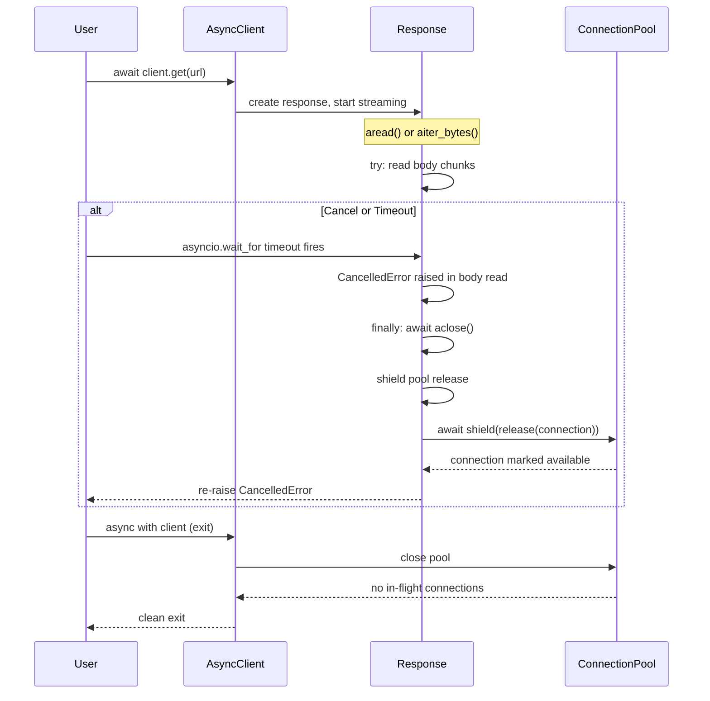
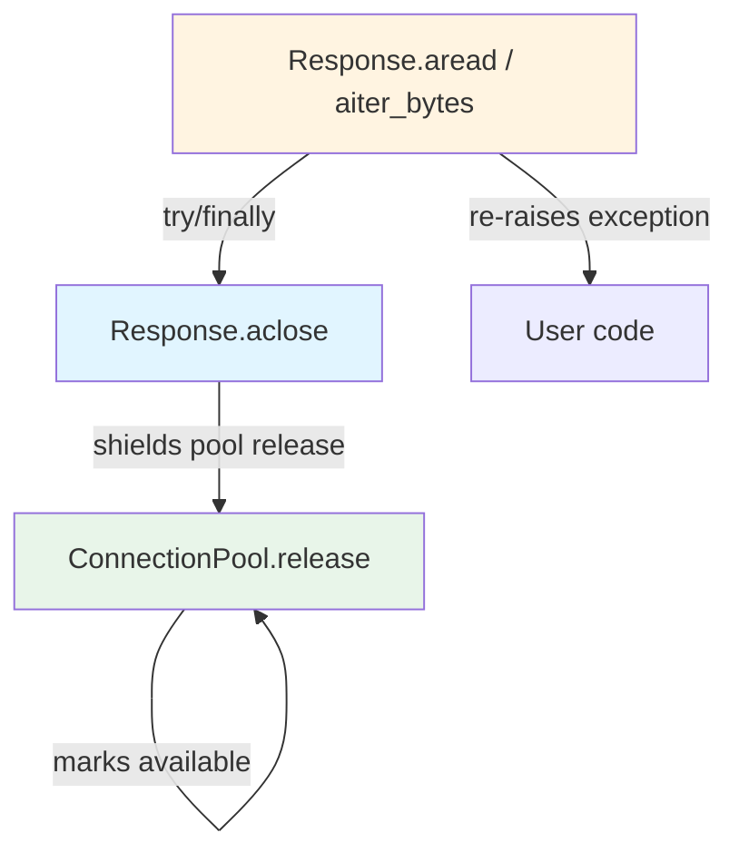

# HLD — Close response stream when async request is cancelled mid-read

**Ticket:** PER-81  
**Type:** Bug  
**Epic:** (standalone)  
**Altitude:** Story  
**Date:** 2025-01-23

---

## Overview

When an `AsyncClient` request is cancelled or times out while streaming a response body, the response stream is not properly closed. This leaves the connection marked as in-flight, causing a `RuntimeError` when the client context manager exits. The fix clarifies ownership of response cleanup during exceptional flow (cancel/timeout) and ensures the connection is returned to the pool in all async interrupt scenarios.

The behavioral outcome: after a cancel or timeout during streaming, the response stream closes, the connection returns to the pool, and the `AsyncClient` context exits cleanly without raising an in-flight connection error.

---

## Architecture Decisions

### AD-1: Response cleanup ownership in streaming methods

**Binds:** `Response.aread()` and `Response.aiter_bytes()` own cleanup on cancel/timeout, not the `AsyncClient` request dispatcher.  
**Prevents:** Divergence where cancel handling is scattered across client dispatcher, response methods, and pool logic.  
**Rule:** Wrap the body read operation in `try/finally` within `Response.aread()` and `Response.aiter_bytes()`. Always call `self.aclose()` in the `finally` block, ensuring cleanup happens on normal exit, cancel (`CancelledError`), and timeout (`TimeoutError`).  
**Status:** `[ADOPTED]` — per review feedback; moves cleanup ownership to response streaming methods.

### AD-2: Response stream closure mechanism

**Binds:** `httpx.Response.aclose()` (async) and `httpx.Response.close()` (sync) are the **only** entry points for releasing the underlying connection back to the pool.  
**Prevents:** Partial cleanup where the stream is marked closed but the connection remains held.  
**Rule:** Any code path that needs to clean up the response MUST call `response.aclose()` (async) or `response.close()` (sync). The response object's close method handles both stream cleanup and pool return atomically.  
**Status:** `[ADOPTED]` — existing design; fix ensures it is always invoked.

### AD-3: Sync/async consistency for cancel handling

**Binds:** The sync `Client` and async `AsyncClient` follow identical cleanup logic: response streaming methods wrap body reads in `try/finally`, call `close()`/`aclose()` in finally block.  
**Prevents:** Divergent behavior where async behaves differently from sync under the same failure mode.  
**Rule:** Sync `Response.read()` and async `Response.aread()` (and their iterator equivalents) share the same structural pattern: a `try/finally` block around the body-reading operation that guarantees `close()`/`aclose()` is called on exit, whether normal or exceptional.  
**Status:** `[ADOPTED]` — AC-3 requires this consistency.

### AD-4: Pool release shielding from cancellation

**Binds:** `Response.aclose()` shields the connection pool release operation with `asyncio.shield()`.  
**Prevents:** Connection leaking when a second cancel fires during `aclose()` execution.  
**Rule:** The pool return call inside `aclose()` (likely `await self._pool.release(self._connection)` or similar) MUST be wrapped in `asyncio.shield()` to ensure the connection is returned even if `aclose()` is cancelled mid-execution.  
**Status:** `[ADOPTED]` — per review feedback; ensures pool release completes atomically.

---

## Components

### 1. Response streaming methods (async)

**Responsibility:** Wrap body read operations in `try/finally`, always call `aclose()` on exit (including cancel and timeout).  
**Location:** `httpx/_models.py` — `Response.aread()` and `Response.aiter_bytes()` methods.  
**Interface (behavioral):**
- **Input:** HTTP response body stream.
- **Output:** Response body content (bytes), or exception (cancel/timeout).
- **Guarantee:** `aclose()` is called in `finally` block, ensuring cleanup happens on normal completion, cancel, or timeout.

**Interaction:** Calls `self.aclose()` on exit; `aclose()` internally returns the connection to the pool.

### 2. AsyncResponse.aclose()

**Responsibility:** Close the response stream and return the underlying connection to the pool atomically, with shielded pool release.  
**Location:** `httpx/_models.py` — `Response.aclose()` method.  
**Interface (behavioral):**
- **Method:** `aclose()` (async) — closes the stream, returns the connection to the pool via shielded call, idempotent.
- **Guarantee:** Calling `aclose()` multiple times is safe (no-op after first call). Pool release completes even if `aclose()` is cancelled mid-execution.

**Interaction:** Invoked by `Response.aread()` and `Response.aiter_bytes()` in `finally` blocks; internally calls `await asyncio.shield(self._pool.release(self._connection))`.

### 3. Connection pool (async)

**Responsibility:** Track in-flight connections and accept returned connections when `aclose()` is called.  
**Location:** `httpx/_async_pool.py` or similar.  
**Interface (behavioral):**
- **Input:** Connection release signal from `response.aclose()`.
- **Output:** Connection marked as available for reuse.
- **Guarantee:** After `response.aclose()`, the connection is no longer counted as in-flight.

**Interaction:** Receives connection release from `response.aclose()`; does **not** detect cancel/timeout itself.

---

## Contracts

### 1. Response cleanup on async cancel

**Parties:** `Response.aread()`/`Response.aiter_bytes()` ↔ `Response.aclose()`  
**Contract:**  
- **Response streaming methods MUST:** Wrap body read in `try/finally`, call `self.aclose()` in `finally` block regardless of exit reason (normal, cancel, timeout).
- **Response.aclose() MUST:** Close the stream and return the connection to the pool atomically, idempotently, with shielded pool release.

**Output format:** No new API; behavioral guarantee that cancel → `finally` → `aclose()` → shielded pool return → clean client exit.

### 2. Sync/async parity

**Parties:** Sync `Response.read()` ↔ Async `Response.aread()`  
**Contract:**  
- **Both MUST:** Implement identical cleanup logic for interrupted response reads (sync: `close()`, async: `aclose()` in `finally`).
- **Both MUST:** Raise no in-flight connection error when the client context exits after a cancel/timeout.

**Output format:** Same `RuntimeError` suppression behavior in both sync and async clients.

---

## Risks & Mitigations

### Risk 1: Cancel raised after response.aclose() already called

**Likelihood:** Low  
**Impact:** Low (double-close is safe if `aclose()` is idempotent)  
**Mitigation:** Ensure `response.aclose()` is idempotent (already required by AD-2). Test double-close scenario.

### Risk 2: Timeout fires in the middle of aclose() itself

**Likelihood:** Low  
**Impact:** Medium (connection might not return to pool if `aclose()` is interrupted)  
**Mitigation:** AD-4 requires shielding pool release inside `aclose()` with `asyncio.shield()`. Add test to verify pool state after cancel during close.

### Risk 3: Sync client diverges from async client in cleanup logic

**Likelihood:** Medium (if fix only touches async code)  
**Impact:** High (AC-3 failure)  
**Mitigation:** Review sync `Response.read()` code path for same issue and apply parallel fix. AC-4 requires regression tests for both sync and async.

### Risk 4: Existing code assumes response auto-closes on context exit

**Likelihood:** Medium  
**Impact:** Medium (potential double-close or missed cleanup elsewhere)  
**Mitigation:** Audit existing uses of `async with response` or explicit `aclose()` calls. Ensure new cleanup does not conflict with existing `__aexit__` behavior (which should also call `aclose()`).

---

## Open Questions

1. **Does the current `Response.aclose()` implementation shield the pool-return logic from cancellation?**  
   - **Context:** If pool release is not shielded, the connection might not return to the pool if `aclose()` is cancelled mid-execution.  
   - **Resolution path:** Inspect `httpx/_models.py` `Response.aclose()` implementation. If pool return is not shielded, add `asyncio.shield()` around the pool release call.

2. **Are there existing `try/finally` blocks in `Response.aread()` or `Response.aiter_bytes()` that already attempt cleanup?**  
   - **Context:** The fix might conflict with or duplicate existing cleanup logic.  
   - **Resolution path:** Grep for `try/finally` in `httpx/_models.py` response methods. Document what exists and ensure new cleanup integrates cleanly.

3. **Does the sync `Response.read()` method require the same fix?**  
   - **Context:** AC-3 requires sync/async parity.  
   - **Resolution path:** Inspect `httpx/_models.py` sync `Response.read()` and `Response.iter_bytes()` methods. If they do not wrap body reads in `try/finally` with cleanup, apply parallel fix.

---

## Deferred

- **Performance optimization of connection pool under high cancel rate:** Out of scope; the fix focuses on correctness (no leak), not throughput.
- **Timeout policy changes (e.g., configurable timeout granularity):** Out of scope per requirements; this fix takes the existing timeout mechanism as-is.
- **Sync client behavior if not currently broken:** Only in scope if AC-3 is violated (i.e., sync behaves differently from async). If sync already handles cancel correctly, document parity and move on.

---

## Diagrams

### Response cleanup flow on async cancel/timeout

### Component ownership of cleanup

---

## Notes

- **Ownership shift:** Per review feedback, cleanup is **not** in the client dispatcher; it is in `Response.aread()` and `Response.aiter_bytes()` using `try/finally`.
- The fix is **not** a one-file cleanup; it spans `httpx/_models.py` (Response streaming methods and `aclose()`), and possibly sync equivalents.
- The core issue is **response lifecycle ownership** during exceptional flow, not during normal completion.
- Sync and async code paths **must** mirror each other to satisfy AC-3.
- The response object's `aclose()` method is the **single source of truth** for connection cleanup; no other code path should attempt to return the connection directly to the pool.

---

## Story Coverage

### Story: Close response stream when async request is cancelled mid-read

**Acceptance Criteria Addressed:**
- **AC-1 (Response closure on cancel):** AD-1, AD-2, AD-4 define the cleanup ownership (response methods), mechanism (`aclose()`), and shielding; `try/finally` ensures `aclose()` is called on `CancelledError`.
- **AC-2 (Response closure on timeout):** Same as AC-1; `TimeoutError` is handled by the same `finally` block.
- **AC-3 (Sync/async consistency):** AD-3 mandates identical cleanup logic in sync `Response.read()` and async `Response.aread()`.
- **AC-4 (Regression test coverage):** Deferred to test_architect step; tests must cover `asyncio.wait_for` cancellation and client-timeout paths.

**Schema/API Notes:**  
- No new public API; behavioral change in existing `Response.aread()`, `Response.aiter_bytes()`, and `Response.aclose()` methods.
- **Data/API work:** None (no new data structures or endpoints).

**Files implicated (inferred, to be confirmed by designer):**
- `httpx/_models.py` (Response.aread, Response.aiter_bytes, Response.aclose — primary changes)
- `httpx/_async_pool.py` (connection pool release logic — audit only, verify shielded release is called)
- `tests/client/test_async_client.py` (new regression tests for cancel/timeout)

---

**End of HLD.**
