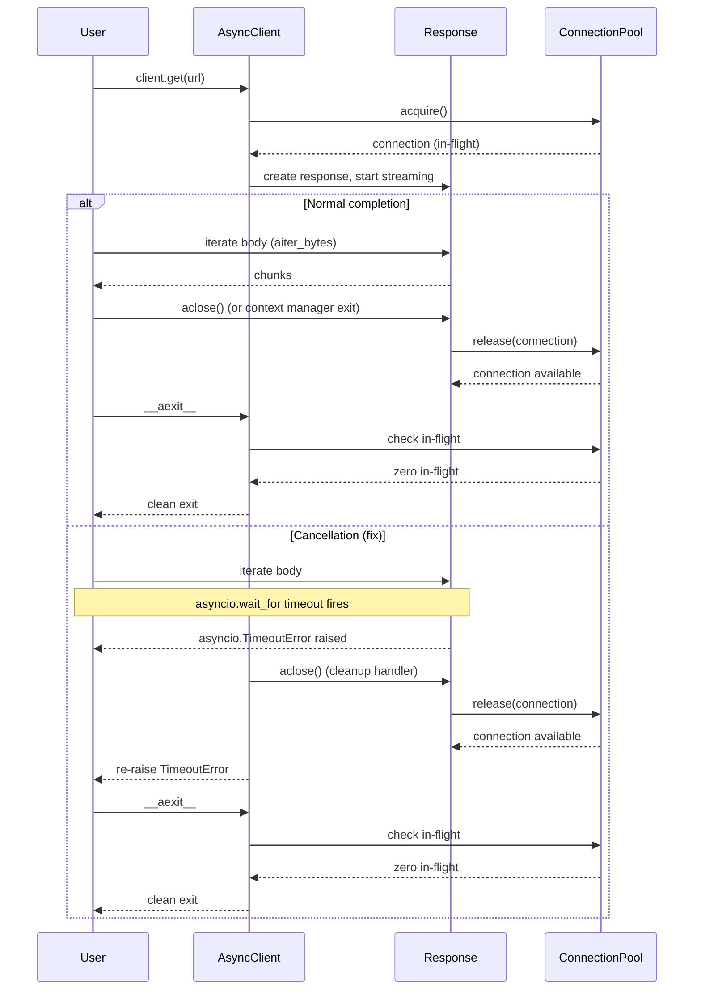

# High-Level Design — Close response stream when async request is cancelled mid-read

**Story ID:** PER-83  
**Epic:** (none — backlog bug)  
**Created:** 2025-01-24  
**Status:** draft

---

## Overview

This HLD documents the async response cleanup mechanism to fix the resource leak when an `AsyncClient` request is cancelled or times out during response body streaming. The fix ensures that cancellation or timeout always closes the response object and returns the connection to the pool, preventing the `RuntimeError: The connection pool was closed while 1 HTTP requests/responses were still in-flight.`

### Scope

- Async response cleanup on cancellation (`asyncio.CancelledError`) or timeout during streaming read
- Connection pool return path when response is closed early
- Consistency between sync and async client cancel/timeout behavior
- Regression test coverage for cancel and timeout scenarios

### Out of Scope

- Changes to connection pool architecture or threading model
- Performance optimization of streaming reads
- Additional timeout configuration options

---

## Architecture Decisions

### AD-1: Async response cleanup on cancellation

**Binds:** `AsyncClient` methods that initiate streaming reads (e.g., `request()`, `stream()`, `send()` when used with response iteration) MUST catch `asyncio.CancelledError` and `asyncio.TimeoutError`, explicitly call `await response.aclose()`, and re-raise the exception.

**Prevents:** Response objects left open after cancellation, leaving connections marked as in-flight in the pool.

**Rule:** Cancellation handling wraps the response body consumption (anywhere a response is yielded to user code or iterated internally). The cleanup block runs unconditionally before re-raising; no silent swallowing of cancellation.

**Status:** `[ADOPTED]` — required by AC1, AC2, and the existing httpx connection pool contract.

---

### AD-2: Connection return via response.aclose()

**Binds:** The connection pool return mechanism MUST be triggered by calling `response.aclose()`. No new cleanup path is introduced; the fix uses the existing `aclose()` contract.

**Prevents:** Inventing parallel cleanup mechanisms that bypass the pool's tracking of in-flight connections.

**Rule:** When `response.aclose()` is called (whether by user code, cleanup, or cancellation handler), the underlying HTTP connection is marked as available and returned to the connection pool. The pool removes the connection from its in-flight tracking at this point.

**Status:** `[ADOPTED]` — existing httpx behavior, ratified by the fix.

---

### AD-3: AsyncClient.__aexit__ enforces no in-flight connections

**Binds:** `AsyncClient.__aexit__()` MUST inspect the connection pool for in-flight connections and raise `RuntimeError` if any are found. This check is not removed; the fix ensures it never triggers by cleaning up responses before exit.

**Prevents:** Silent connection leaks that would otherwise go undetected.

**Rule:** The `__aexit__` check is a safeguard; it MUST NOT be bypassed or weakened. The fix addresses the root cause (unclosed responses) rather than relaxing the check.

**Status:** `[ADOPTED]` — existing httpx behavior, unchanged by this fix.

---

### AD-4: Cancellation propagates after cleanup

**Binds:** After catching `asyncio.CancelledError` or `asyncio.TimeoutError` and closing the response, the exception MUST be re-raised unchanged.

**Prevents:** Swallowing cancellation, which would break asyncio task cancellation semantics and user expectations.

**Rule:** The cleanup block runs in a `try/except/finally` structure or equivalent; `finally` re-raises the caught exception after `response.aclose()` completes. No exception conversion or suppression.

**Status:** `[ADOPTED]` — required by asyncio cancellation protocol.

---

### AD-5: Sync client parity for timeout behavior

**Binds:** The sync `Client` MUST exhibit the same connection cleanup behavior on timeout during streaming read as the async client: close the response and return the connection to the pool without raising an in-flight error on client exit.

**Prevents:** Inconsistent resource management between sync and async APIs, leading to user confusion and duplicate bugs.

**Rule:** Review the sync client's timeout handling during streaming reads; if it does not already close the response on timeout, apply the same fix as the async client. Document any intentional behavioral differences (e.g., threading model differences) that prevent full parity.

**Status:** `[ADOPTED]` — required by AC3.

---

## Components

### Component: AsyncClient Request Lifecycle

**Module:** `httpx/_client.py` (`AsyncClient` class)

**Responsibilities:**

- Initiate HTTP requests and manage response lifecycle
- Handle async iteration of response bodies via `response.aiter_bytes()` and similar methods
- **New:** Catch cancellation and timeout during response body streaming, close response, and return connection to pool

**Interfaces (post-fix):**

- `async request(method, url, ...)` → `Response`
  - Wraps response body consumption in `try/except` for `asyncio.CancelledError` and `asyncio.TimeoutError`
  - On exception, calls `await response.aclose()` before re-raising

- `async stream(method, url, ...)` → async context manager yielding `Response`
  - Ensures response is closed on exit, even if user code does not consume the stream fully
  - Cancellation during context manager body triggers cleanup before propagating

- `async __aexit__(...)` → None
  - Existing check for in-flight connections unchanged; fix ensures it never triggers

**Data Contracts:**

- **Response object state:**
  - Open: connection in-flight, tracked by pool
  - Closed: connection returned to pool, removed from in-flight tracking
  - Closing a response is idempotent; calling `aclose()` multiple times is safe

**Cancel/Timeout Handling Contract:**

- **Cancel scenario:** User code wraps `client.get(url)` in `asyncio.wait_for(timeout=<duration>)`. When timeout fires, asyncio raises `asyncio.TimeoutError` in the task executing `client.get()`. The fix catches this at the response iteration layer, closes the response, and re-raises.

- **Timeout scenario:** `AsyncClient(timeout=<duration>)` is configured. Internal timeout mechanism raises `asyncio.TimeoutError` during `response.aread()` or `aiter_bytes()`. The fix catches this, closes the response, and re-raises.

- **Connection pool interaction:** When `response.aclose()` is called, the pool's `release(connection)` method is invoked, marking the connection as available and removing it from in-flight tracking. The pool's `__aexit__` check then finds zero in-flight connections and exits cleanly.

---

### Component: Connection Pool In-Flight Tracking

**Module:** `httpx/_transports/` (connection pool implementation, e.g., `AsyncConnectionPool` in `default.py`)

**Responsibilities:**

- Track connections as in-flight while responses are open
- Return connections to the available pool when responses are closed
- **Unchanged:** Raise `RuntimeError` if in-flight connections exist on pool close

**Interfaces (existing, ratified by fix):**

- `async acquire(...)` → `AsyncHTTPConnection`
  - Marks connection as in-flight

- `async release(connection)` → None
  - Called by `response.aclose()`, marks connection as available, removes from in-flight set

- `async aclose()` → None
  - Checks in-flight set; raises `RuntimeError` if non-empty

**Data Contracts:**

- **In-flight set:** Connections currently held by open responses
- **Available set:** Connections returned to pool and ready for reuse
- Transitions: `acquire()` moves connection to in-flight; `release()` moves it to available

**Post-condition (with fix):**
No connections remain in-flight when `AsyncClient.__aexit__()` is called, because all responses are closed by cancellation handlers or normal cleanup.

---

## Data Flow

### Normal Request Flow (no cancellation)

1. User calls `client.get(url)`
2. `AsyncClient.request()` acquires connection from pool → connection in-flight
3. Response headers received, `Response` object created
4. User iterates response body via `async for chunk in response.aiter_bytes()`
5. Stream completes, response context manager `__aexit__` calls `response.aclose()`
6. `aclose()` calls pool's `release(connection)` → connection returned to available set
7. `AsyncClient.__aexit__` checks pool → zero in-flight connections → clean exit

### Cancel During Stream Flow (with fix)

1. User wraps `client.get(url)` in `asyncio.wait_for(timeout=3)`
2. `AsyncClient.request()` acquires connection from pool → connection in-flight
3. Response headers received, `Response` object created, streaming begins
4. **Timeout fires:** asyncio raises `asyncio.TimeoutError` in the task
5. **Fix:** Cancellation handler in `request()` or response iteration layer catches exception
6. **Fix:** Handler calls `await response.aclose()` → pool's `release(connection)` runs → connection returned to available set
7. **Fix:** Handler re-raises `asyncio.TimeoutError`
8. User code catches exception (or propagates to top-level)
9. `AsyncClient.__aexit__` checks pool → zero in-flight connections → clean exit, no `RuntimeError`

### Timeout During Stream Flow (client-configured timeout)

Same flow as cancel, but the timeout exception originates from httpx's internal timeout mechanism rather than `asyncio.wait_for`. Fix applies the same cleanup.

---

## Response Cleanup Mechanism Detail

### Where the cleanup happens

**Primary location:** `AsyncClient.request()` and any method that yields a response to user code or iterates the response body internally.

**Mechanism:**

```python
# Pseudo-code (not actual implementation)
try:
    response = await self._send_request(...)
    # If streaming, user code or internal iteration happens here
    yield response  # or return response
except (asyncio.CancelledError, asyncio.TimeoutError):
    # Fix: close response if it exists and is not already closed
    if response is not None:
        await response.aclose()
    raise
```

### Idempotency

- `response.aclose()` is idempotent; calling it multiple times is safe
- If user code explicitly closes the response before cancellation, the cleanup handler still runs but does nothing

### Sync client equivalent

The sync `Client` uses threading-based timeouts; the fix for sync is analogous but uses `response.close()` (sync) instead of `await response.aclose()`. The sync client's timeout mechanism must be reviewed to ensure it triggers cleanup on timeout mid-stream.

---

## Risks and Mitigations

### R1: Cleanup runs during response iteration in user code

**Risk:** If user code is iterating the response body and cancellation occurs, the cleanup handler may attempt to close the response while the iteration is still in progress, potentially causing a race or double-close.

**Mitigation:**
- `response.aclose()` is designed to be idempotent and safe to call at any point in the response lifecycle
- The response object's internal state machine ensures that closing mid-iteration is handled cleanly
- Existing tests for response lifecycle (e.g., closing a response mid-stream) verify this behavior
- New tests will cover cancellation during active iteration to confirm no regression

**Likelihood:** Low (response API is designed for this)  
**Impact:** Medium (could cause cleanup failure if not handled)  
**Status:** Accepted (mitigation via existing API contract and new tests)

---

### R2: Sync and async cleanup paths diverge

**Risk:** The sync `Client` may have a different cancellation/timeout path that does not trigger cleanup, leading to inconsistent behavior between sync and async APIs.

**Mitigation:**
- AC3 requires explicit verification of sync client behavior
- LLD will include a review of the sync client's timeout mechanism during streaming reads
- If sync client does not already close responses on timeout, apply the same fix
- Document any unavoidable differences (e.g., threading model limitations)

**Likelihood:** Medium (sync and async code paths differ in structure)  
**Impact:** Medium (user confusion, duplicate bugs)  
**Status:** Accepted (mitigation via AC3 verification)

---

### R3: Performance impact of exception handling

**Risk:** Adding `try/except` blocks in the hot path of response iteration could degrade performance for the common case (no cancellation).

**Mitigation:**
- Exception handling in Python has negligible overhead when no exception is raised
- The fix only adds cleanup logic to the exceptional path (cancel/timeout), not the normal path
- Existing httpx response handling already includes exception handling for other errors (network errors, decoders)
- No new allocations or blocking calls in the happy path

**Likelihood:** Very Low (exception handling is cheap in Python when not raised)  
**Impact:** Low (performance is not materially affected)  
**Status:** Accepted (no significant overhead)

---

## Testing Strategy

### Unit Tests

**Location:** `tests/client/test_async_client.py`

**New tests (per AC4):**

1. `test_async_cancel_during_stream_closes_response` (AC1)
   - Setup: Local ASGI app that streams bytes with `asyncio.sleep()` delays between chunks
   - Action: Wrap `client.get(url)` in `asyncio.wait_for(timeout=<short>)` that fires mid-stream
   - Assert: `asyncio.TimeoutError` is raised, no `RuntimeError` on `async with client` exit, connection pool in-flight count is zero

2. `test_async_timeout_during_stream_closes_response` (AC2)
   - Setup: `AsyncClient(timeout=<short>)` against slow-streaming ASGI app
   - Action: Timeout fires mid-stream, raising timeout exception
   - Assert: Timeout exception is raised, no `RuntimeError` on client exit, connection pool in-flight count is zero

3. `test_sync_client_timeout_during_stream` (AC3, in `tests/client/test_client.py` if sync behavior differs)
   - Setup: Sync `Client` with timeout against slow-streaming endpoint
   - Action: Timeout mid-stream
   - Assert: No in-flight error on client exit, behavior consistent with async client

**Test fixture:** Local ASGI app defined in test file or `conftest.py` that yields bytes with controllable delays (using `asyncio.sleep()` or `time.sleep()` for sync). Do NOT use external `httpbin.org`.

### Integration Tests

**Existing tests to verify:** `tests/test_timeouts.py` — ensure existing timeout tests still pass and document any gaps.

### Edge Cases

- User closes response explicitly before cancellation → cleanup handler runs but does nothing (idempotent)
- Multiple concurrent requests cancelled → each response cleaned up independently
- Cancellation during response header read (before body streaming starts) → existing error handling covers this; fix focuses on mid-stream cancellation

---

## Open Questions

(none)

---

## Deferred Decisions

- **Logging or telemetry for cancelled requests:** This fix does not add logging for cancellation events. If observability is needed, it should be added in a separate story with a broader logging strategy.
- **Timeout configuration enhancements:** No changes to timeout configuration API or semantics; this fix only addresses cleanup on existing timeout behavior.

---

## Appendix: Connection Pool Interaction Diagram



---

## References

- Story: `stories/01-Https-test.md`
- Requirements: `requirements.md`
- Repo: `Https-test` (https://github.com/pavithrachandran70/httpx-demo)
- Base branch: `master`
